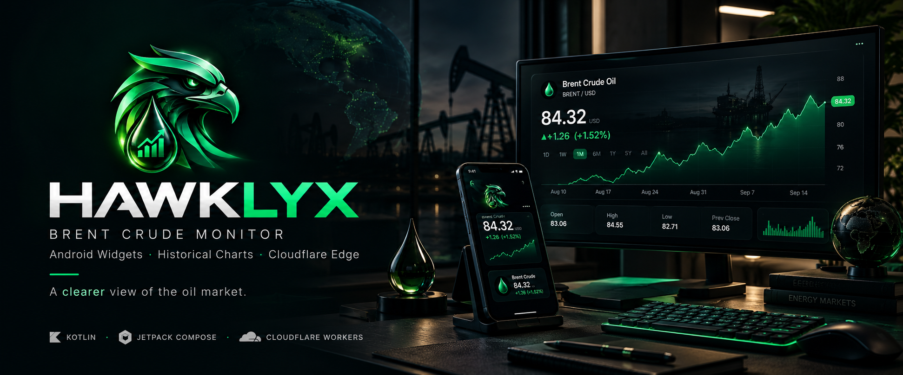
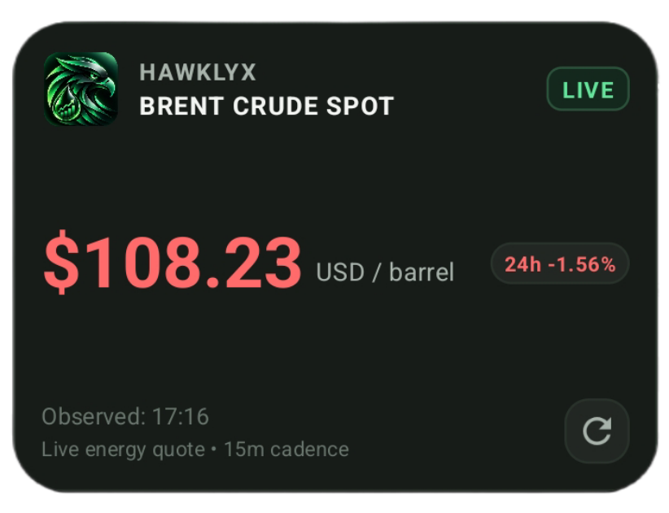
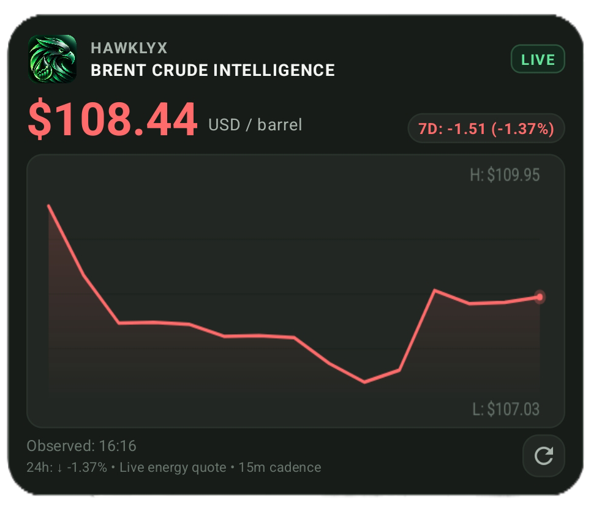
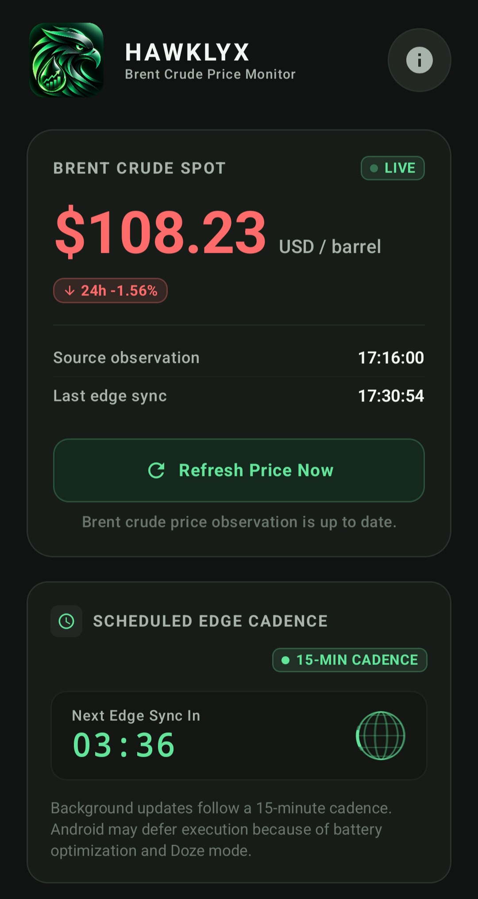
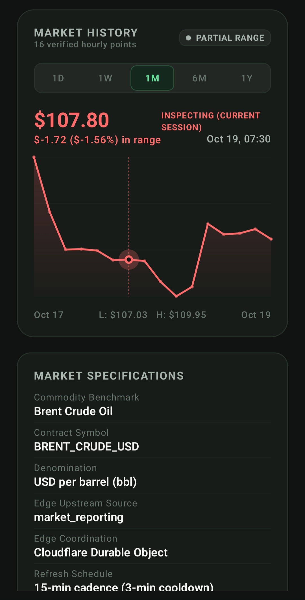
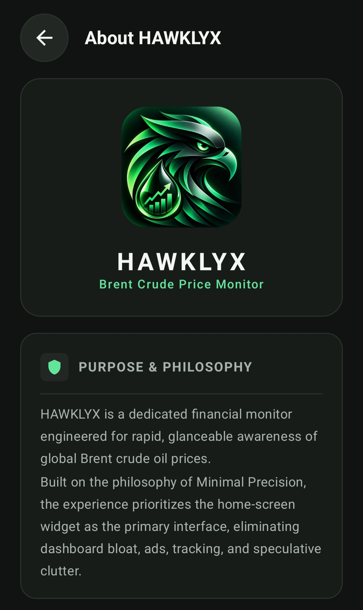
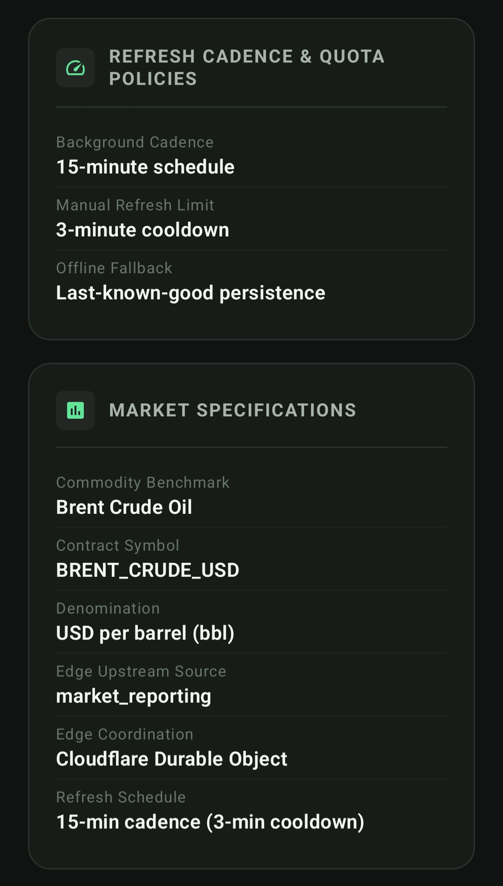
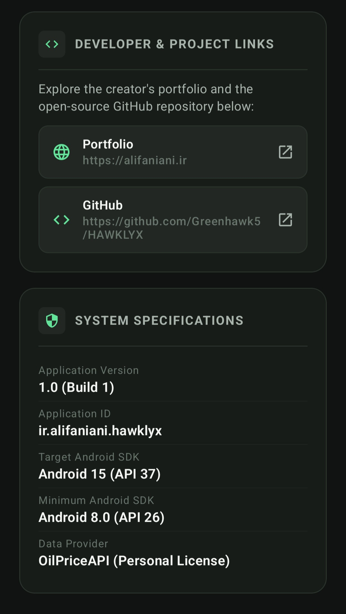

<div align="center">



# HAWKLYX

### Brent Crude Monitor · Android Widgets · Cloudflare Edge

**Follow Brent crude oil prices from your Android home screen.**

[Repository](https://github.com/Greenhawk5/HAWKLYX) ·
[Features](#-features) ·
[Screenshots](#-screenshots) ·
[Getting Started](#-getting-started) ·
[Security](#-security--privacy)

[](https://github.com/Greenhawk5/HAWKLYX/actions/workflows/ci.yml)
[](https://github.com/Greenhawk5/HAWKLYX/releases/latest)


[](LICENSE)


</div>

---

## ✦ About

**HAWKLYX** is an Android application for monitoring Brent crude oil prices (`BRENT_CRUDE_USD`). It combines a dark market interface, two Android home-screen widgets, interactive historical charts, and a Cloudflare Worker backend that coordinates upstream requests and preserves the last verified quote when the provider is unavailable.

The guiding principle is simple: **market data should be easy to glance at, honest about its freshness, and resilient when connectivity or upstream services fail.**

> A clear market snapshot at a glance. Deeper historical context when you need it.

## ✦ At a glance

| | |
|---|---|
| **Instrument** | Brent crude oil, quoted in USD per barrel |
| **Android app** | Kotlin, Jetpack Compose, Android home-screen widgets |
| **Minimum Android version** | Android 8.0 (API 26) |
| **Backend** | Cloudflare Workers + SQLite-backed Durable Objects |
| **Upstream data provider** | OilPriceAPI |
| **Historical data** | Verified hourly observations and daily rollups |
| **License** | MIT — see [`LICENSE`](LICENSE) |
| **Release status** | Stable `v1.1.0`; see [GitHub Releases](https://github.com/Greenhawk5/HAWKLYX/releases/tag/v1.1.0) for published builds |

## ✦ Features

| **📊 Market Snapshot widget** | **📈 Market Intelligence widget** |
|:---|:---|
| Compact home-screen quote card. | Larger quote-and-chart layout. |
| Prominent Brent price and `USD / barrel` denomination. | Mini-chart rendered from available observations. |
| Market status and data freshness. | Price-change metrics and market context. |
| Observation timestamp and dedicated refresh control. | Historical chart and manual refresh action. |
| Tap to open the app. | Uses recorded observations only — no generated chart points. |

| **🧭 Interactive market history** | **🎨 Market-aware visual language** |
|:---|:---|
| Select `1D`, `1W`, `1M`, `6M`, or `1Y` ranges. | Emerald for positive movement. |
| Inspect individual observations. | Ruby/red for negative movement. |
| Review range summaries and high/low context. | Amber for a closed or paused market. |
| Hourly observations and daily rollups for longer ranges. | Explicit freshness and error states. |
| Partial-history indicators when a range is not fully populated. | Consistent colors across the app and widgets. |

### Reliability by design

- **Server-side provider credentials:** upstream API keys do not belong in the Android client.
- **Coordinated upstream requests:** a Durable Object centralizes shared limits and helps prevent duplicate concurrent fetches.
- **Request coalescing:** concurrent refreshes can share an in-flight provider request.
- **Last-known-good preservation:** provider failures do not replace a valid quote with a fabricated value or zero.
- **Sanity checks:** implausible quotes can be rejected instead of blindly displayed.
- **Controlled refreshes:** shared request budgets and cooldowns help protect upstream allowances.
- **Background collection:** scheduled Worker execution can collect observations independently of the Android app.

---

## ✦ Screenshots

Explore the HAWKLYX product experience across its Android home-screen widgets, the main market overview, interactive historical charts, and architectural transparency screens.

### Android Home-Screen Widgets

Glanceable, low-overhead widgets engineered to deliver live Brent crude quotes and analytical trends directly to your Android launcher.

| Market Snapshot Widget (3×2) | Market Intelligence Widget (4×3) |
|:---:|:---:|
|  |  |
| **Instant Glanceable Spot Quote**<br>High-contrast Brent price numeral ($108.23), live freshness status badge (`LIVE`), 24-hour delta pill (`-1.56%`), source observation timestamp, and direct manual refresh trigger. | **Historical Mini-Chart & Trends**<br>Real-time sparkline trajectory, high/low range boundaries ($109.95 / $107.03), 7-day movement metrics (`-1.37%`), and active trading session context. |

---

### Home Screen — Market Overview & History

The primary application interface provides immediate market awareness, background sync countdowns, interactive chart scrubbing, and contract specifications.

| Live Spot & Edge Cadence | Interactive History & Specifications |
|:---:|:---:|
|  |  |
| **Live Spot & Edge Cadence**<br>Hero price card with real-time status, source observation timestamp (17:16:00), last edge sync time (17:30:54), manual refresh button, and next sync countdown timer. | **Interactive Charting & Specs**<br>Touch inspection with vertical crosshair, multi-timeframe range selection (`1D`, `1W`, `1M`, `6M`, `1Y`), high/low markers, and commodity contract specifications. |

---

### About Screen — Transparency & Architecture

Full architectural disclosure, refresh cadence policies, developer attribution, and build specifications.

| Brand Identity & Philosophy | Refresh Policies & Specifications | Developer Links & System Specs |
|:---:|:---:|:---:|
|  |  |  |
| **Purpose & Philosophy**<br>Falcon brand mark and minimal precision design principles prioritizing the widget interface. | **Policies & Specifications**<br>Background schedules (15m), cooldown limits (3m), offline fallback, and Durable Object coordination. | **System & Developer Specs**<br>Creator portfolio, GitHub repository, versioning (`1.0 Build 1`), and Android SDK targets (API 26–37). |

---

## ✦ Architecture

```text
┌──────────────────────┐
│      OilPriceAPI     │
│   Upstream quote     │
└──────────┬───────────┘
           │ Authenticated server-side request
           ▼
┌──────────────────────────────────────────┐
│       HAWKLYX Cloudflare Worker           │
│                                          │
│  ┌────────────────────────────────────┐  │
│  │ Coordinator Durable Object          │  │
│  │ SQLite-backed state                 │  │
│  └────────────────────────────────────┘  │
│  • Shared request budget                 │
│  • Cooldown and request coalescing       │
│  • Quote validation and cache            │
│  • Hourly observations / daily rollups   │
└───────────────────┬──────────────────────┘
                    │ JSON API
                    ▼
┌──────────────────────────────────────────┐
│          HAWKLYX Android app             │
│                                          │
│  Compose UI · Historical chart            │
│  Repository · Local last-good cache       │
│  WorkManager · Two home-screen widgets    │
└──────────────────────────────────────────┘
```

### Data flow

1. The Worker requests a quote when cache state, market status, and request policy allow it.
2. The coordinator validates the result and preserves the last known valid quote if an upstream request fails.
3. Valid observations are recorded for historical charting; chart reads do not need to trigger extra upstream quote requests.
4. The Android repository exposes data to the app and widgets, while local persistence can retain the last known quote for offline display.
5. The UI communicates price movement and data freshness so cached data is not mistaken for a newly observed quote.

### Backend API

| Endpoint | Purpose |
|---|---|
| `GET /api/v1/price/latest` | Latest available quote and freshness metadata |
| `GET /api/v1/price/history` | Historical observations for supported ranges |
| `GET /health` | Sanitized operational health information |

---

## ✦ Technology stack

| **Area** | **Technology** |
|:---|:---|
| Android UI |   |
| Android widgets |   |
| Android language |  |
| Background sync |  |
| Local state |  |
| Backend runtime |  |
| Coordination & persistence |   |
| Backend language |  |
| Backend tests |  |
| Android tests |  |
| Build system |  |

---

## ✦ Repository structure

```text
HAWKLYX/
├── .github/
│   ├── ISSUE_TEMPLATE/           # Bug reports and feature requests
│   ├── workflows/                # GitHub Actions CI
│   ├── CODEOWNERS
│   ├── dependabot.yml
│   └── PULL_REQUEST_TEMPLATE.md
├── app/
│   └── src/
│       ├── main/
│       │   ├── java/ir/alifaniani/hawklyx/
│       │   │   ├── data/          # API, models, preferences, repository
│       │   │   ├── domain/        # Market calendar and price calculations
│       │   │   ├── ui/            # Screens, chart, components and theme
│       │   │   ├── util/          # Time and formatting helpers
│       │   │   └── widget/        # Providers, coordinator, renderer, worker
│       │   └── res/               # Layouts, drawables, widget metadata
│       └── test/                  # Android unit tests
├── backend/
│   └── worker/
│       ├── src/                   # Worker, coordinator and provider logic
│       ├── test/                  # Backend tests
│       ├── wrangler.jsonc         # Worker configuration, if present
│       └── package.json
├── gradle/                        # Wrapper and version catalog
├── doc/
│   ├── banner.png                 # Repository header banner
│   └── screenshots/               # Real product & widget screenshots
├── CHANGELOG.md
├── CITATION.cff
├── CONTRIBUTING.md
├── LICENSE
├── NOTICE.md
├── REPOSITORY_HARDENING.md
├── SECURITY.md
├── SUPPORT.md
└── README.md
```

---

## ✦ Getting started

### Requirements

- Android Studio with a compatible Android SDK.
- Android SDK Platform 37, as configured by the current project.
- A supported JDK; Android Studio's bundled JBR is recommended.
- Node.js and npm for backend development.
- A Cloudflare account and correctly configured Worker bindings for backend development.

### 1. Clone the repository

```bash
git clone https://github.com/Greenhawk5/HAWKLYX.git
cd HAWKLYX
```

### 2. Build and test Android

On Windows PowerShell:

```powershell
.\gradlew.bat --no-configuration-cache test --rerun-tasks
.\gradlew.bat --no-configuration-cache lintDebug
.\gradlew.bat --no-configuration-cache assembleDebug
```

On macOS/Linux:

```bash
./gradlew --no-configuration-cache test --rerun-tasks
./gradlew --no-configuration-cache lintDebug
./gradlew --no-configuration-cache assembleDebug
```

The debug APK is generated at:

```text
app/build/outputs/apk/debug/app-debug.apk
```

You can also open the repository in Android Studio, wait for Gradle sync, select a connected Android device, and run the `app` configuration.

### 3. Set up the Cloudflare Worker

```bash
cd backend/worker
npm ci
npm run typecheck
npm test
npm audit
npm run build
```

For local development, use the environment-variable template provided by the project, if present, to create your local `.dev.vars` file. Add your own development credentials there. **Never commit `.dev.vars` or real API keys.**

The configured `npm run build` performs a Wrangler dry-run build if that is how the package script is defined; it should not be treated as a deployment command.

---

## ✦ Data limits and market behavior

HAWKLYX is designed to operate within constrained upstream API allowances.

- **Shared daily request budget:** the coordinator enforces the configured global budget.
- **Automated collection reserve:** part of the budget is reserved for scheduled market observations.
- **Manual refresh cooldown:** repeated manual refreshes are rate-limited.
- **Cache-aware requests:** cached data can be returned without contacting the provider.
- **Historical reads:** chart history is served from stored observations and rollups rather than requiring a fresh upstream quote for every chart interaction.
- **Market closure:** prices may remain unchanged while the market is closed; the UI communicates market state rather than implying movement.
- **No fabricated history:** chart points represent stored observations only. Longer ranges may remain partial until sufficient history accumulates.

The current backend policy has been documented as a maximum of **250 upstream requests per UTC day**, with **110 reserved for scheduled collection** and a **140-request ceiling for manual requests**. These are implementation settings, not a guarantee of provider availability. Verify the deployed Worker configuration before relying on production limits.

---

## ✦ Security & privacy

- Provider API credentials must remain server-side and must never be embedded in the Android app.
- Local development secrets belong in ignored local configuration files, not source control.
- The health endpoint should expose only sanitized aggregate operational data.
- The app may retain the last verified quote locally to improve resilience during temporary connectivity failures.
- Market data may be delayed or cached. HAWKLYX is not a trade-execution platform and does not provide financial advice.

Please review [`SECURITY.md`](SECURITY.md) before reporting a vulnerability. Never open public issues containing credentials, tokens, or private account information.

---

## ✦ Troubleshooting

| Symptom | What to check |
|---|---|
| The quote appears unchanged | Check market status, observation timestamp, and freshness state. A closed market or cached response can legitimately preserve the same value. |
| A widget does not update immediately | Check connectivity, WorkManager/background restrictions, and the widget's freshness indicator. Android may defer background work. |
| Manual refresh does not trigger a provider request | The shared cooldown, cache, or global budget may be active. A refresh action does not guarantee a new upstream call. |
| The chart marks a range as partial | The backend may not yet have accumulated observations for the full selected period. |
| Worker tests fail | Run `npm ci` from `backend/worker/` and use a Node.js version compatible with the project. |
| Android build cannot find SDK Platform 37 | Install the configured SDK platform through Android Studio's SDK Manager, then sync Gradle again. |

---

## ✦ Project documentation

| Document | Description |
|---|---|
| [`CHANGELOG.md`](CHANGELOG.md) | Release notes and change history |
| [`CONTRIBUTING.md`](CONTRIBUTING.md) | Contribution workflow and development expectations |
| [`CODE_OF_CONDUCT.md`](CODE_OF_CONDUCT.md) | Community standards |
| [`SECURITY.md`](SECURITY.md) | Security reporting policy |
| [`SUPPORT.md`](SUPPORT.md) | Support channels |
| [`REPOSITORY_HARDENING.md`](REPOSITORY_HARDENING.md) | Security architecture and repository hardening |
| [`CITATION.cff`](CITATION.cff) | Citation metadata |
| [`NOTICE.md`](NOTICE.md) | Third-party notices and attributions |
| [`LICENSE`](LICENSE) | MIT license text |

---

## ✦ Release status & Download

HAWKLYX is released as stable `v1.1.0`. Published builds, release notes, and verified assets are available via GitHub Releases.

### Download HAWKLYX v1.1.0

- **Direct APK Download**: [`HAWKLYX-v1.1.0.apk`](https://github.com/Greenhawk5/HAWKLYX/releases/download/v1.1.0/HAWKLYX-v1.1.0.apk)
- **Release Page**: [HAWKLYX v1.1.0 Release](https://github.com/Greenhawk5/HAWKLYX/releases/tag/v1.1.0)
- **All Releases**: [GitHub Releases](https://github.com/Greenhawk5/HAWKLYX/releases)
- [CI runs](https://github.com/Greenhawk5/HAWKLYX/actions/workflows/ci.yml)
- [Report a bug](https://github.com/Greenhawk5/HAWKLYX/issues/new)

Release artifacts, signing, and release tags should only be considered official when published by the repository owner.

---

## ✦ License

HAWKLYX is distributed under the [MIT License](LICENSE). See the license file for the complete terms.

## ✦ Author

**Ali Faniani**

- [GitHub profile](https://github.com/Greenhawk5)
- [HAWKLYX repository](https://github.com/Greenhawk5/HAWKLYX)

<div align="center">

---

*Built with Kotlin, Jetpack Compose, Android Widgets, TypeScript, and Cloudflare Workers.*

</div>
